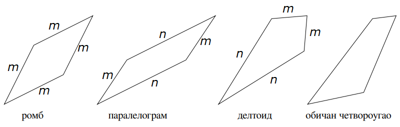

*Аутор: Милан Вугделија*

Написати програм који за дужине страница $AB$, $BC$, $CD$, $DA$ четвороугла дате 
редом, утврђује да ли је тај четвороугао ромб, паралелограм (који није уједно и ромб), 
делтоид (који није уједно и ромб) или обичан четвороугао (који није ништа од претходног).

Ромб је четвороугао коме су све четири странице једнаке. Паралелограм је четвороугао 
коме су по две наспрамне странице једнаке. Делтоид је четвороугао коме су по две 
суседне странице једнаке. У овом задатку обичним називамо четвороугао који није ни ромб, 
ни паралелограм, ни делтоид.

## Улаз

Четири цела позитивна броја, сваки у посебном реду. Бројеви нису већи од 100.

## Излаз

Једна од речи ROMB, PARALELOGRAM, DELTOID, OBICAN

## Пример 1

### Улаз

~~~
9
9
9
9
~~~

### Излаз

~~~
ROMB
~~~

## Пример 2

### Улаз

~~~
5
6
6
7
~~~

### Излаз

~~~
OBICAN
~~~
