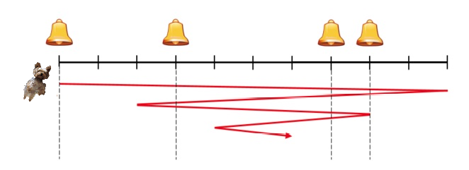

*Аутор: Душан Попадић*

Пас звани Ћуки трчи по правој стази дужине $L$. На стази се на одређеним местима налазе звонца, а сваки пут када Ћуки пролази поред звонца, оно зазвони. Када Ћуки стигне до краја стазе он се окреће и трчи ка почетку, када стигне на почетак онда опет ка крају и тако даље. Сваки пут када се Ћуки окрене (ка почетку или ка крају), он скраћује дистанцу коју прелази до следећег окрета за $d$. Када дистанца коју треба да претрчи постане 0 (или мања од 0) Ћуки стаје. Одреди колико је пута свако звоно зазвонило током Ћукијевог трчања.

## Улаз

У првом реду стандардног улаза се налазе три цела броја: дужина стазе $L$ ($10 \leq L \leq 10^{18}$), скраћење $d$ ($1 \leq d \leq L$, $L$ је дељиво са $d$) и број звонца $n$ ($1 \leq n \leq 10^6$).
У наредних $n$ редова се налази по један цео број $x_i$ ($0 \leq x_i \leq L$) који представља удаљенсот $i$-тог звонца од почетка стазе.

### Ограничења
У тест примерима вредним 50 поена важи $\dfrac{L}{d} \leq 50$.

## Излаз

У $n$ редова стандардног излаза исписати колико пута је свако звонце зазвонило током Ћукијевог трчања и то редом којим су се уносила звонца.

## Пример

### Улаз

~~~
10 2 4
0
3
7
8
~~~

### Излаз

~~~
1
3
4
3
~~~

### Објашњење
На слици испод се може видети Ћукијева путања, као и колико пута је прошао поред ког звонца.

