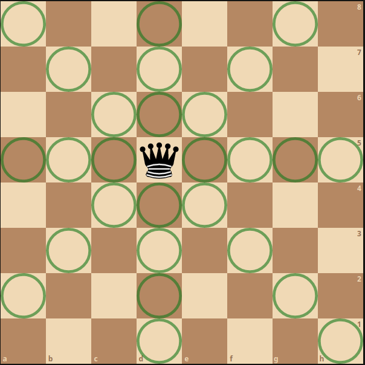
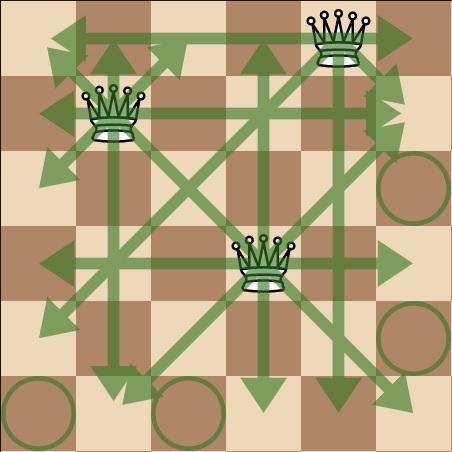

*Аутор: Душан Попадић*

На шаховској табли димензија $m \times m$ постављено је $n$ дама. Дама се у шаху креће тако што може да се помери на било које поље које је у истом реду, истој колони или на истој дијагонали на којој се налази (*слика*). Написати програм који проверава колико постоји поља на табли на које ниједна дама не може стићи у једном потезу. Поља на којима се даме налазе на почетку се не рачунају.

## Улаз

У првом реду стандардног улаза се налазе два броја $m$ ($1 \leq m \leq 2000$) и $n$ ($0 \leq n \leq 100000$) одвојена размаком.
У наредних $n$ редова се налазе по два броја која означавају позицију у матрици сваке од дама (прво ред, па колона). Горње лево поље је (0,0).

### Ограничења

У тест примерима вредним 50% поена важи $m \leq 50, n \leq 10$.

## Излаз

У једини ред стандардног улаза исписати број тражених поља.

## Пример 1

### Улаз

~~~
6 3
1 1
0 4
3 3
~~~

### Излаз

~~~
4
~~~

### Објашњење

Даме не могу доћи на поља (2, 5), (4, 5), (5, 0) и (5, 2) (*слика*).

## Пример 2

### Улаз

~~~
3 1
1 1
~~~

### Излаз

~~~
0
~~~
