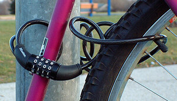

*Аутор: Филип Марић*

Катанац за бицикл има шифру која се састоји од четири цифре. Свака
цифра се поставља тако што се прстен на ком је исписано свих десет
цифара може вртети у круг. Напиши програм који за унету исправну шифру
и тренутно намештен код на катанцу одређује најмањи број окретања
прстена потребних да би се катанац откључао.

## Улаз

Са стандардног улаза се учитава четвороцифрени број (може да почне и
нулама) који предтавља исправну шифру, а затим и четвороцифрени број
(може да почне и нулама) који представља почетну позицију прстена на
катанцу.

## Излаз

На стандардни излаз исписати најмањи број окрета прстенова.

## Пример 1

### Улаз

~~~
1234
7249
~~~

### Излаз

~~~
10
~~~

### Објашњење

- Прстен на коме пише 7 можемо да окренемо 4 пута унапред да бисмо
  дошли до цифре 1 (са 7 на 8, са 8 на 9, са 9 на 0 и са 0 на 1).
  
- Прстен на коме пише 2 не морамо да окрећемо.

- Прстен на коме пише 4 можемо да окренемо једном уназад да бисмо
  дошли до цифре 3.
  
- Прстен на коме пише 9 можемо да окренемо 5 пута (било унапред, било
  уназад) да бисмо дошли до цифре 4.

## Пример 2

### Улаз

~~~
4812
0319
~~~

### Излаз

~~~
12
~~~
