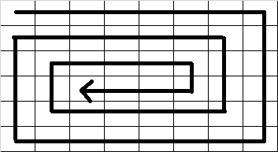

*Аутор: Душан Попадић*

Немања има 6 година и почео је да учи да чита и пише. Од стрица је добио вежбанку за учење слова у којој се налази вежбица "Пуж". Наиме у овој вежбици постоји табела димeнзија $n$ x $m$ у коју је потребно уписати неку реченицу на следећи начин: креће се из горњег левог угла табеле и уписују се слова ка десној ивици табеле докле може. Када се стигне до ивице онда се наставља уписивање на доле до ивице, затим на десно до ивице, па на горе док има места, онда опет на десно и тако док се не попуни цела табела (слика). У табелу се уписују само слова, игноришу се размаци, знакови интерпункције и слично. Пошто је Немања сувише мали за ову вежбу, табелу је попунио стриц. Немању сада занима да ли се у реченици која је коришћена да се попуни табела налази име његовог омиљеног суперхероја. Пошто Немања још не зна сва слова, помозите му да ово открије.

## Улаз

У првом реду стандардног улаза се налазе два цела броја $n$ и $m$ ($2 \leq n, m \leq 50$) која редом представљају број редова и број колона ове табеле.
У наредних $n$ редова се налази по $m$ карактера (мала слова енглеске абецеде) који сви заједно представљају попуњену табелу.
У наредном реду се налази ниска карактера (дужине до 30) која представља име Немањининог омиљеног суперхероја (такође мала слова енглеске абецеде, без размака и знакова интерпункције).

## Излаз

У једином реду стандардног излаза исписати један цео број који представља позицију у реченици од које почиње име траженог суперхероја. У случају да име не постоји исписати -1.
Уколико се име појављује више пута, исписати почетну позицију првог појављиавања.

## Пример 1

### Улаз

~~~
4 5
mnogo
jdrmv
aaneo
psmil
spajdrmen
~~~

### Излаз

~~~
11
~~~

### Објашњење
Када се табела развије добија се ниска карактера mnogovolim**spajdrmen**a, тако да се реч spajdrmen појављује почевши од 11. места.

## Пример 2

### Улаз

~~~
5 5
dalis
rnuui
ccudt
oivoi
adelg
crnaudovica
~~~

### Излаз

~~~
-1
~~~

### Објашњење
Иако се у реченици прича о Црној удовици, низ карактера crnaudovica се не појављује јер је њено име у реченици у падежу (акузативу).
