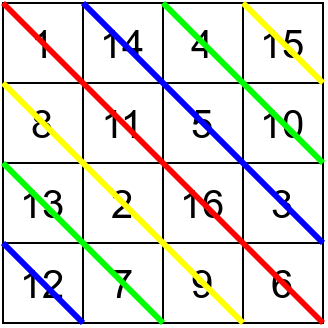

*Аутори: Милан Вугделија, Филип Марић*

Написати програм који за $n \times n$ бројева распоређених у квадрат проверава да ли је
збир дуж сваке "главне изломљене дијагонале" једнак. Квадрат са овом особином зваћемо 
занимљив квадрат. На следећој слици је приказан један занимљив квадрат величине $4 \times 4$, 
а свака од његове четири главне изломљене дијагонале је означена по једном бојом.

На првој (црвеној) дијагонали, збир бројева је $1 + 11 + 16 + 6 = 34$, на другој (плавој) 
$14+5+3+12 = 34$, на трећој (зеленој) $4+10+13+7 = 34$, а на четвртој (жутој) $15+8+2+9=34$. 

## Улаз

У првој линији стандардног улаза налази се димензија квадрата $n$ ($1 \leq n \leq 20$), а 
у свакој од $n$ наредних линија по $n$ природних бројева раздвојених по једном размаком, 
који представљају један ред квадрата. Вредности бројева у квадрату су између 1 и 2000.

## Излаз

На стандардни излаз исписати $n$ природних бројева, сваки у посебном реду. Ови бројеви треба 
да буду збирови елемената главних изломљених дијагонала редом. У $n+1$-вом реду исписати `da` 
ако су сви збирови једнаки, односно `ne` ако нису.

## Пример 1

### Улаз

~~~
4
1 14 4 15
8 11 5 10
13 2 16 3
12 7 9 6
~~~

### Излаз

~~~
34
34
34
34
da
~~~

## Пример 2

### Улаз

~~~
4
16 9 2 7
6 3 12 13
11 14 5 4
1 8 15 10
~~~

### Излаз

~~~
34
26
34
42
ne
~~~

## Пример 3

### Улаз

~~~
1
17
~~~

### Излаз

~~~
17
da
~~~
