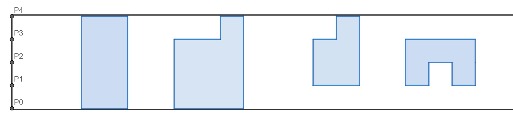
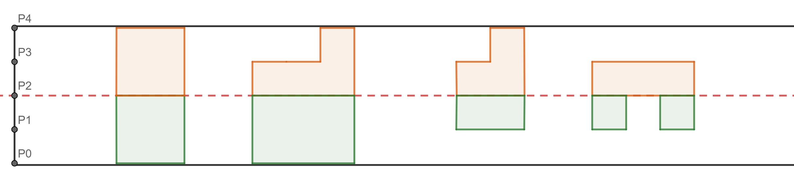

*Аутор: Огњен Нешковић*

Ана и Биљана спремају дрво за огрев за зиму. Ана је насекла комаде дрва разних величина и облика и истоварила их на траку. На траци се налази тестера која сече комаде дрвета на два дела. Тестера се поставља на неку позицију на почетку, затим се укључује трака и дрва се крећу ка тестери. Када комад дрвета дође до тестере он бива пресечен на два дела, један део пада са леве, други са десне стране траке. <b>У току сечења се тестера не може померати.</b>

Биљана треба да одлучи где да постави тестеру тако да се сво дрво подели што боље. Ана и Биљана су одлучиле да након што се заврши сечење, <b>Ана ће узети све што је пало са леве стране, а Биљана све што је пало са десне стране. Биљана хоће да постави тестеру тако да она и Ана добију што сличнију количину дрвета.</b>

Биљана има прилично напредну машину за сечење која је сликала све комаде дрвета кад су били постављени и забележила облике приближно као квадратиће.

<em>Пример података са Биљанине машине</em>

Биљана може поставити тестеру на позиције: $0,1,2,...,k$. На пример, на претходној слици Биљана може поставити тестеру на позиције $0,1,2,3$ и $4$. Уколико постави тестеру на позицију $2$ дрво ће бити подељено на следећи начин:

Ана ће у овом случају добити 4+4+3+3=14 комада дрвета, а Биљана: 4+6+2+2=14

<b>Помозите Биљани и напишите програм који ће за дате облике дрвета пронаћи најбоље место за тестеру тако да је апсолутна разлика комада дрвета које Ана и Биљана добију што мања.</b>

## Улаз

У првом реду стандардног улаза уноси се природан број $n \leq 10^7$ - број комада дрвета на траци.

У другом реду стандардног улаза уноси се природан број $k \leq 10^7$ - највећа димензија дрвета.

Затим се уноси $n$ матрица димензије $k \times k$. Свака од матрица сачињена је од $k$ редова од по $k$ бројева ($0$ - машина није детектовала дрво на том месту или $1$ - машина је детектовала дрво на том месту).
У свим тест примерима важи $n * k * k \leq 10^7$.
## Излаз

У једом реду стандардног излаза исписати минималну апсолутну разлику између комада дрвета које ће Ана и Биљана добити ако се тестера постави оптимално.

## Пример 1

### Улаз

~~~
4
4
1 1 0 0
1 1 0 0
1 1 0 0
1 1 0 0
0 0 1 0
1 1 1 0
1 1 1 0
1 1 1 0
0 1 0 0
1 1 0 0
1 1 0 0
0 0 0 0
0 0 0 0
1 1 1 0
1 0 1 0
0 0 0 0
~~~

### Излаз

~~~
0
~~~

## Објашњење

Ово је пример из текста задатка.

## Пример 2

### Улаз

~~~
4
3
1 1 1
1 0 1
0 0 0
1 0 1
1 0 1
1 1 0
0 0 0
0 1 1
0 0 1
0 0 0
1 1 0
1 1 0
~~~

### Излаз

~~~
8
~~~

## Објашњење

Разлика 8 се постиже ако се тестера постави на позицију 1 или на позицију 2.

## Пример 3

### Улаз

~~~
3 
5
1 0 0 0 0
1 1 0 0 1
0 0 0 0 1
0 0 0 0 1
0 0 0 0 0
0 1 1 0 1
0 1 0 0 0
0 0 0 0 0
0 1 0 0 0
0 0 0 0 0
0 1 1 1 0
0 0 0 0 0
0 0 1 1 0
0 0 1 1 1
0 0 0 1 0
~~~

### Излаз

~~~
2
~~~

## Објашњење

Разлика 2 се постиже ако се тестера постави на позицију 3.
