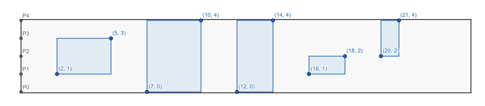
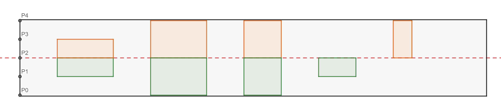

*Аутор: Огњен Нешковић*

Ана и Биљана спремају дрво за огрев за зиму. Ана је насекла комаде дрва разних димензија и истоварила их на траку. На траци се налази тестера која сече комаде дрвета на два дела. Тестера се поставља на неку позицију на почетку, затим се укључује трака и дрва се крећу ка тестери. Када комад дрвета дође до тестере он бива пресечен на два дела, један део пада са леве, други са десне стране траке. <b>У току сечења се тестера не може померати.</b>

Биљана треба да одлучи где да постави тестеру тако да се сво дрво подели што боље. Ана и Биљана су одлучиле да након што се заврши сечење, <b>Ана ће узети све што је пало са леве стране, а Биљана све што је пало са десне стране. Биљана хоће да постави тестеру тако да она и Ана добију што сличнију количину дрвета.</b>

Комади дрвета су сви прилично правилног облика. Биљана има напредну машину за сечење која је сликала све комаде дрвета кад су били постављени и забележила облике приближно као правоугаонике.

<em>Пример података са Биљанине машине</em>

Биљана може поставити тестеру на позиције: $0,1,2,...$. На пример, на претходној слици, уколико Биљана постави тестеру на позицију $2$ дрво ће бити подељено на следећи начин:

Ана ће у овом случају добити 3+6+4+2=15 комада дрвета, а Биљана: 3+6+4+2=15

<b>Помозите Биљани и напишите програм који ће за дате облике дрвета пронаћи најбоље место за тестеру тако да је апсолутна разлика комада дрвета које Ана и Биљана добију што мања.</b>

## Улаз

У првом реду стандардног улаза уноси се природан број $n \leq 5*10^5$ - број комада дрвета на траци.

У наредних $n$ линија стандардног улаза уносе се по 4 броја раздвојена белинама $0 \leq x_0,y_0,x_1,y_1 \leq 10^{9}$.

Који представљају редом x и y координате доњег левог темена правоугаоника, x и y координату горњег десног темена правоугаоника.

У $10\%$ тест примера ће важити $n \leq 20$ и $\text{max}_y \leq 200$ где је $\text{max}_y$ највећа унета y-координата.

У $25\%$ тест примера ће важити $n * \text{max}_y \leq 5 * 10^5$.

## Излаз

У једом реду стандардног излаза исписати минималну апсолутну разлику која се може постићи ако се тестера позиционира оптимално.

## Пример 1

### Улаз

~~~
5
2 1 5 3
7 0 10 4
12 0 14 4
16 1 18 2
20 2 21 4
~~~

### Излаз

~~~
0
~~~

## Објашњење

Ово је пример из текста задатка.

## Пример 2

### Улаз

~~~
5
2 3 5 5
5 0 7 2
8 1 10 5
11 2 13 7
14 0 18 1
~~~

### Излаз

~~~
4
~~~

## Објашњење

Најмања разлика (4) се постиже ако се тестера постави на позицију 3.
