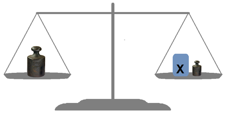

*Аутор: Милан Вугделија*

На двостраној ваги (теразијама), предмет се мери тако што се стави на једну страну ваге, а 
затим се тегови познатих маса стављају на обе стране док се не постигне равнотежа. Тада је 
збир маса на једној страни једнак збиру маса на другој страни, па маса предмета може да се 
израчуна. 

На пример, ако је вага у равнотежи када се на страни са предметом налази тег од $2\mathrm{Kg}$, а на 
супротној страни тег од $5\mathrm{Kg}$, закључујемо је маса предмета $X = 5\mathrm{Kg} - 2\mathrm{Kg} = 3\mathrm{Kg}$.

Написати програм који одређује најмању масу која може да се измери једним мерењем на двостраној 
ваги, ако су нам на располагању три тега познатих маса. Приликом мерења могу да се користе један, 
два или сва три тега, а сваки тег може да се стави на једну или другу страну.

## Улаз

На стандардном улазу се налазе три цела неозначена броја, сваки у посебном реду, масе тегова. 
Бројеви припадају интервалу $[1, 10000]$.

## Излаз

На стандардни излаз исписати један цео позитиван број, тражену најмању масу која може да се измери.

## Пример 1

### Улаз

~~~
2
5
7
~~~

### Излаз

~~~
2
~~~

## Пример 2

### Улаз

~~~
5
12
4
~~~

### Излаз

~~~
1
~~~

## Пример 3

### Улаз

~~~
3
12
7
~~~

### Излаз

~~~
2
~~~
