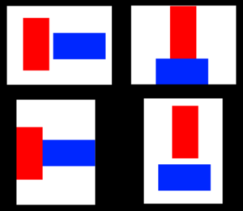
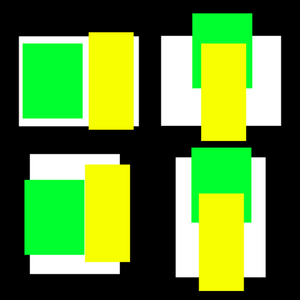
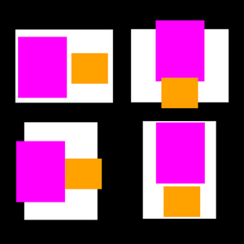

*Аутори: Филип Марић, Владимир Кузмановић*

Написати програм који испитује колико постоји исправних распореда две
слике познатих димензија на папир познатих димензија, тако да су ивице
слика паралелне ивицама папира, да су слике приказане целе и да се не
преклапају. Слике није допуштено ротирати, али папир јесте (могуће је
постављати га било у хоризонталној "пејзаж" оријентацији, било у
вертикалној "портрет" оријентацији). Слике је допуштено постављати
било једну испод друге било једну поред друге, на папир који је
окренут било хоризонтално, било вертикално (постоји, дакле, највише 4
могућа распореда, при чему неки од њих могу бити неисправни, јер су
слике превелике).

## Улаз

Са стандардног улаза се уносе димензије (ширина и висина) папира,
димензије прве слике и димензије друге слике.

## Излаз

На стандардни излаз исписати број од 0 до 4 који представља број
могућих начина да се слике распореде на папир.

## Пример 1

### Улаз

~~~
800 600
200 400
400 200
~~~

### Излаз

~~~
4
~~~

### Објашњење

4 исправна распореда слика

## Пример 2

### Улаз

~~~
800 600
400 500
300 650
~~~

### Излаз

~~~
0
~~~

### Објашњење

4 неисправна распореда слика

## Пример 3

### Улаз

~~~
800 600
400 500
300 250
~~~

### Излаз

~~~
2
~~~

### Објашњење

2 исправна и 2 неисправна распореда слика

