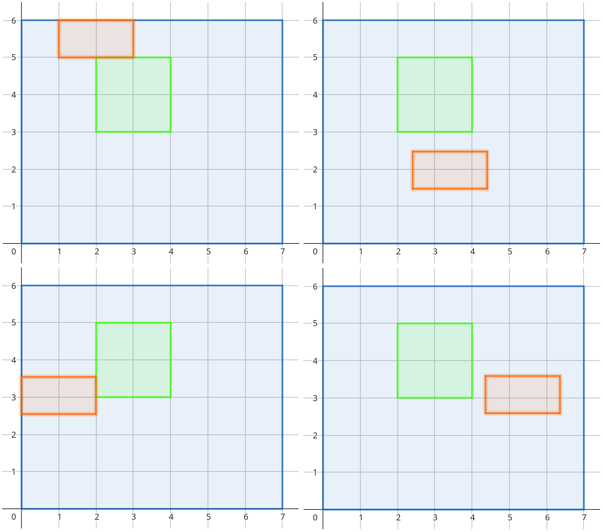

*Аутори: Иван Дрецун, Владимир Кузмановић*

Душан се усељава у нови стан и жели да донесе своје ствари у кутијама. Познат
је план стана који је правоугаоног облика. У стану постоји један стуб који је у
плану такође правоугаоног облика. Потребно је одредити максималне димензије
правоугаоне кутије тако да се кутија може кретати са свих страна стуба.
Странице свих правоугаоника су паралелне осама и кутија неће бити ротирана.
Напиши програм који за дати план стана помаже Душану да одреди димензије
кутије.

## Улаз

Са стандардног улаза се уноси шест целих бројева. Прва два представљају дужину
и ширину стана. Наредна два представљају дужину и ширину стуба. Последња два
представљају удаљености стуба од левог и доњег зида стана, тим редом. Сваки
број се уноси у засебном реду.

## Излаз

На стандардни излаз исписати два цела броја који редом представљају дужину и
ширину кутије. Бројеве исписати у истом реду, одвојене размаком.

## Пример 1

### Улаз

~~~
7
6
2
2
2
3
~~~

### Излаз

~~~
2 1
~~~

## Пример 2

### Улаз

~~~
6
6
3
3
2
1
~~~

### Излаз

~~~
1 1
~~~

## Пример 3

### Улаз

~~~
6
5
3
1
2
2
~~~

### Излаз

~~~
1 2
~~~
