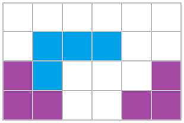

*Аутор: Милан Вугделија*

Дата је позиција у игри тетрис, а потребно је утврдити да ли фигура која пада може да се 
помери лево, десно или наниже за једно поље. У овом задатку се не разматра могућност 
окретања фигуре.

## Улаз

У првом реду стандардног улаза су број редова $R$ и број колона $K$ табле, раздвојени једним 
размаком. Ови бројеви су цели, позитивни и нису већи од 20.

У сваком од наредних $R$ редова је по $K$ цифара без размака. Свака цифра је 0, 1, или 2. Нуле 
представљају празна поља, јединице поља која заузимају делови претходних фигура, а двојке 
представљају поља од којих се састоји активна фигура, тј. фигура која се помера.

## Излаз

На стандардни излаз исписати три речи, сваку у посебном реду. Свака од те три речи треба да 
буде ``da`` или ``ne``. Оне су редом одговори на питања да ли фигура може да се помери лево, 
десно, односно доле.

## Пример

### Улаз

~~~
4 6
000000
022200
120001
110011
~~~

### Излаз

~~~
ne
da
ne
~~~

### Објашњење

Дата матрица (или низ ниски, тј. стрингова) представља позицију у игри приказану на следећој 
слици. фигура која пада (задата бројевима 2) је обојена плаво, а поља која су попуњена 
деловима претходних фигура (задата бројевима 1) су љубичаста. Фигура може да се помера само 
надесно, па је само други одговор ``da``, а први (за лево) и трећи (за доле) су ``ne``.

