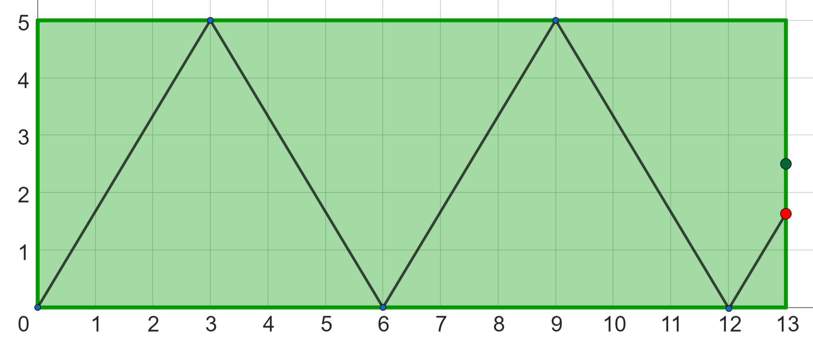

*Аутор: Владан Ковачевић*

Дат је билијарски сто облика правоугаоника висине $n$ и ширине $m$.
Бела кугла започиње кретање из доњег левог угла и удара у горњу ивицу, на растојању $d$ од леве ивице. Она се затим одбија ка доњој ивици стола, па ка горњој и тако даље, све док не дотакне десну ивицу (слика). Одредити да ли ће она десну ивицу да дотакне у средишту, испод средишта или изнад средишта.

## Улаз

Са стандардног улаза се у једном реду уносе три позитивна цела броја $n$, $m$ и $d$ ($1 \leq n, m \leq 100000$, $1 \leq d \leq 100$) раздвојена размацима.

## Излаз

На стандардни излаз исписати $0$, $-1$ или $1$, у зависности од тога да ли ће кугла да дотакне десну ивицу у средишту, испод средишта или изнад средишта.

## Пример 1

### Улаз

~~~
5 13 3
~~~

### Излаз

~~~
-1
~~~

## Пример 2

### Улаз

~~~
4 7 2
~~~

### Излаз

~~~
0
~~~
