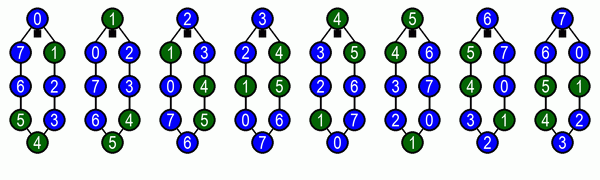
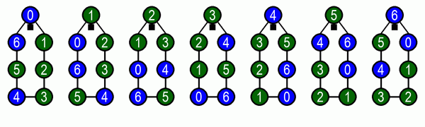

*Аутор: Милан Вугделија*

Дата је огрлица од $n$ перли, од којих је свака плава или зелена. Када једну перлу држимо, остале 
перле висе са леве или десне стране, а у случају да је укупан број перли паран, једна перла 
је тачно испод оне коју држимо (није ни лево ни десно).

Написати програм који за учитани распоред перли, за сваку перлу одговара на следеће питање: 
ако ту перлу држимо, да ли је више плавих перли са њене леве или десне стране?

## Улаз

На стандардном улазу је ниска слова у једном реду, без размака. Свако од слова је или ``P`` 
или ``Z``, где слова ``P`` означавају плаве, а слова ``Z`` зелене перле. Укупан број слова 
је мањи од 50000.

## Излаз

На стандардни излаз исписати без размака онолико слова, колико их има на улазу. Свако од 
исписаних слова треба да буде ``N``, ``L`` или ``D``, при чему слово ``N`` значи да је број 
плавих перли са леве и десне стране подједнак, слово ``L`` значи да више плавих перли има са 
леве, а слово ``D`` да их више има са десне стране. 

## Пример 1

### Улаз

~~~
PZPPZZPP
~~~

### Излаз

~~~
NLLLNDDD
~~~

### Објашњење

Огрлица има 8 перли и налазиће се у следећих 8 положаја редом. 

На свакој од ових осам слика, горња перла је она коју држимо, по три перле су са леве и десне 
стране, а најнижа није ни са једне стране. Бројеви на перлама одговарају индексима слова из 
улазне ниске.

На првој слици имамо по две плаве перле са сваке стране, дакле подједнако, па је прво слово 
на излазу слово ``N``. Да другој слици имамо три плаве перле са леве, а две са десне стране, 
дакле лево има више плавих па је друго слово на излазу слово ``L`` итд.

## Пример 2

### Улаз

~~~
PZZZPZP
~~~

### Излаз

~~~
LLLDDDN
~~~

### Објашњење

Огрлица има 7 перли и налазиће се у следећих 7 положаја редом. 

У овом случају не постоји доња перла, тј. свака перла осим оне коју држимо је или са леве, или 
са десне стране. Из односа броја плавих перли са леве и десне стране добија се одгвоор.
