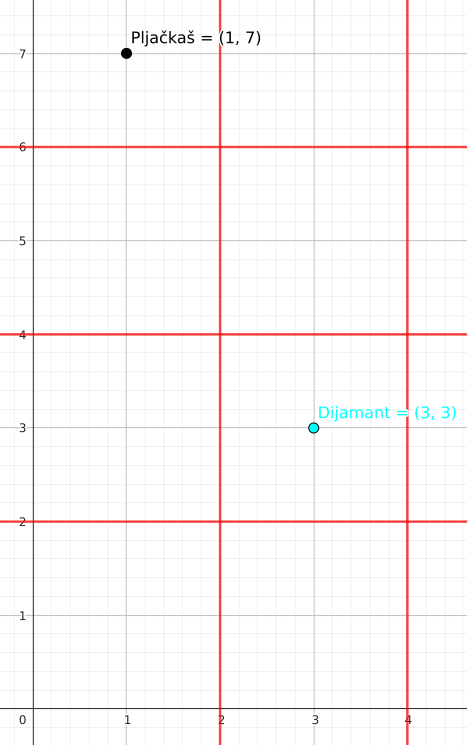
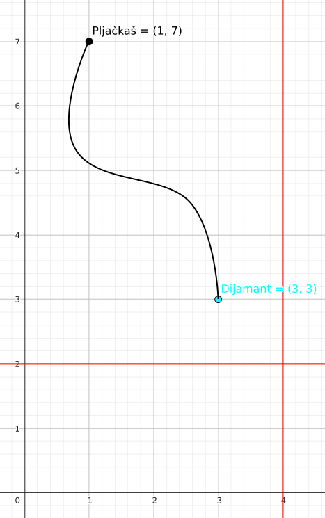
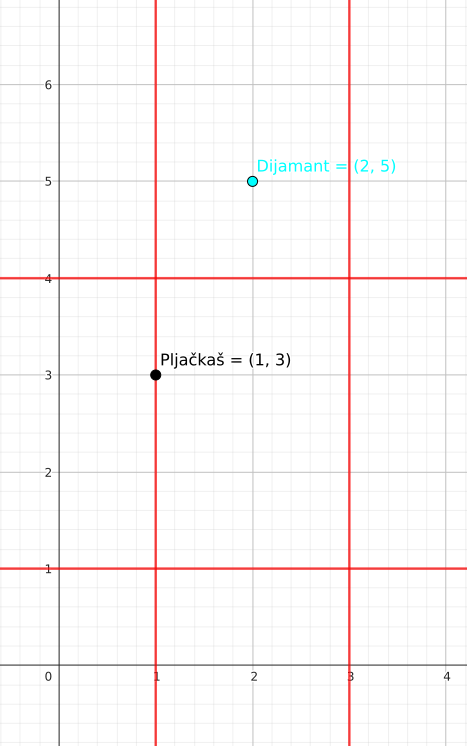
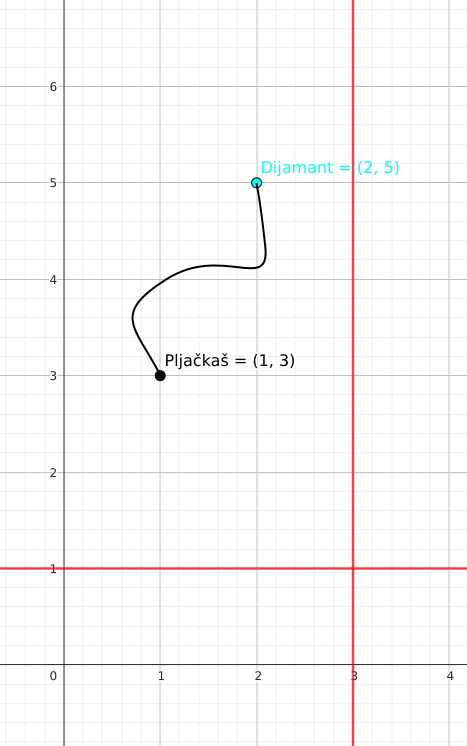

Озлоглашени пљачкаши Тоша и Моша испланирали су да украду драгоцени дијамант. Оно што овај подухват чини тежим него раније јесте нови ласерски безбедносни систем постављен у просторијама где се дијамант налази.

Моша је успео да сазна да су ласери постављени веома специфично; постоји тачно $n$ вертикалних ласера, где је $i$-ти ласер постављен на позицију $v_i$ и $m$ хоризонталних ласера, постављени на позицију $h_i$ (ласере можемо посматрати као праве представљене једначином $x=v_i$ за вертикалне, односно $y=h_i$ за хоризонталне ласере).

У међувремену, Тоша је сазнао да један прозор на врху зграде може да се отвори, па ако се спустe низ конопац кроз њега, наћи ће се на координатама $(x_1, y_1)$ у соби, а да је тачна локација дијаманта на координатама $(x_2, y_2)$.

Све што је преостало је да се ласери онеспособе. Зато, Тошу и Мошу интересује колико минимално ласера морају да искључе да би могли да дођу до дијаманта, а да при томе не буду на правцу ниједног ласера. Да ли можете да им помогнете?

## Улаз

У првом реду стандардног улаза налазе се целобројне вредности $x_1$ и $y_1$ раздвојене размаком, координате места у соби на коме се Тоша и Моша налазе на почетку.

У другом реду налазе се целобројне вредности $x_2$ и $y_2$ раздвојене размаком, координате дијаманта у просторији.

У трећем реду налази се природан број $n$, број вертикалних ласера.

У четвртом реду налази се $n$ целобројних вредности раздвојених размаком, где $i$-та вредност $v_i$ представља $x$ координату вертикалног ласера.

У петом реду налази се природан број $m$, број хоризонталних ласера.

У шестом реду налази се $m$ целобројних вредности раздвојених размаком, где $i$-та вредност $h_i$ представља $y$ координату хоризонталног ласера.

## Излаз

Природан број који представља минималан број ласера које Тоша и Моша морају да искључе.

## Ограничења

$-10^9 \leq x_1, y_1, x_2, y_2 \leq 10^9$

$1 \leq n, m \leq 10^5$

$-10^9 \leq v_i, h_i \leq 10^9$

## Пример 1

### Улаз

~~~
1 7
3 3
2
2 4
3
2 4 6
~~~

### Излаз

~~~
3
~~~

### Објашњење

Минималан број ласера које морамо да искључимо је 3, на пример хоризонталне ласере на позицијама $y = 6$ и $y = 4$ и вертикалан ласер на позицији $x = 2$.

| Почетно стање | После искључивања |
| --- | --- |
|  |  |

## Пример 2

### Улаз

~~~
1 3
2 5
2
1 3
2
1 4
~~~

### Излаз

~~~
2
~~~

### Објашњење

Минималан број ласера које морамо да искључимо је 2, на пример хоризонтални ласер на позицији $y = 4$ и вертикалан ласер на позицији $x = 1$.

| Почетно стање | После искључивања |
| --- | --- |
|  |  |
