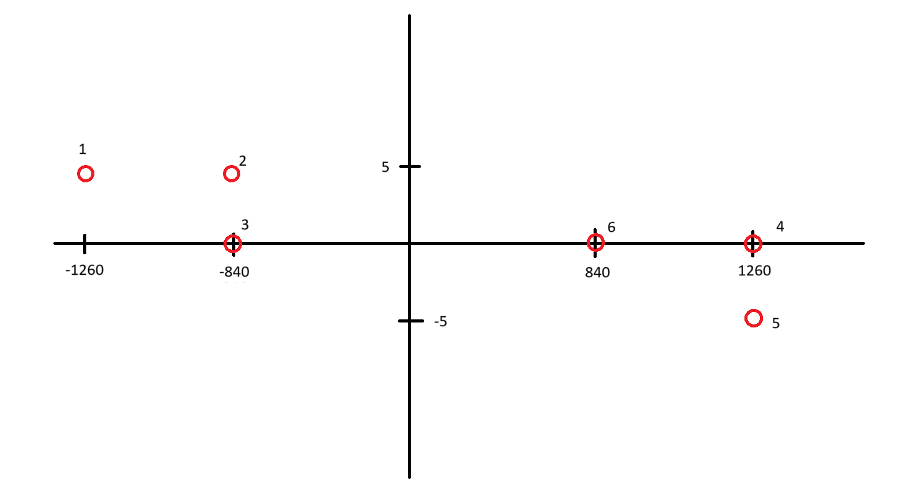

*Аутор: Душан Попадић*

На чаробној планети Аљмез објекти могу да имају позитивну и негативну масу. На тој планети се налази велики координатни систем на који је Анави поставила лагане лопте дуж y-осе. Све лопте које је поставила имају апсолутну вредност масе између 0,1 и 0,15 гк-а (гк је мера за масу на Аљмезу), с тим што је Анави водила рачуна да буде приближно једнак број лопти са позитивном и негативном масом (ти бројеви се разликују за највише 1).
Анавин млађи брат Пилиф тренира лабдуф (спорт у коме је дозвољено само трчање уназад и додиривање лопте ногама) и жели да вежба свој шут. Он прилази свакој лопти и шутира је истом јачином од 126 A (A je мерна јединица за јачину шута лопте) у правцу одређеном x-осом (дакле не мења се y-координата лопте). 
Лопта лети и пада на место чија се x-координата добија када се јачина шута (126) подели масом лопте. На пример ако имамо лопту чија је y-координата 20,3 и маса -0,15, она ће слетети на место са координатама (-840, 20,3) јер је 126/-0,15 = -840.
Када је Анави видела шта је Пилиф урадио, прво се јако наљутила, а онда му рекла да мора да покупи све лопте. Пошто Пилифа наравно мрзи да то уради, замолио те је да му помогнеш тако што ћеш одредити којим редом да купи лопте тако да укупна дистанца коју пређе буде најкраћа могућа.
Занемари дистанцу коју Пилиф треба да пређе од своје тренутне позиције до прве лопте са твог списка. У случају више тачних решења исписати било које.

### Помоћ:
Ако имамо две лопте на координатама $(x_1, y_1)$ и $(x_2, y_2)$, растојање између њих се рачуна као $\sqrt{(x_1-x_2)^2 + (y_1-y_2)^2}$.

## Улаз

У првом реду стандардног улаза се налази $n$ $(3 \leq n \leq 14)$, број лопти које је Анави поставила.
У наредних $n$ редова се налазе по два броја раздвојена размаком: $y$-координата лопте $(-30 \leq y_i \leq 30)$ и маса лопте $(0.1 \leq |m| \leq 0.15)$.

### Ограничења
- У тест примерима вредним 10 поена важи $y_i = 0$.
- У тест примерима вредним 50 поена важи $n \leq 8$.

## Излаз

У једином реду стандардног излаза исписати n различитих бројева одвоједних размаком -- тражени редослед лопти.
На пример, ако Пилиф треба да оде прво по 3. лопту која је унета на улазу, па по прву, па по другу исписати 3 1 2.

## Пример

### Улаз

~~~
6
5 -0.1
5 -0.15
0 -0.15
0 0.1
-5 0.1
0 0.15
~~~

### Излаз

~~~
1 2 3 6 4 5
~~~

### Објашњење

Са слике се види да је тражени распоред оптималан. Алтернативно решење је 5 4 6 3 2 1.

