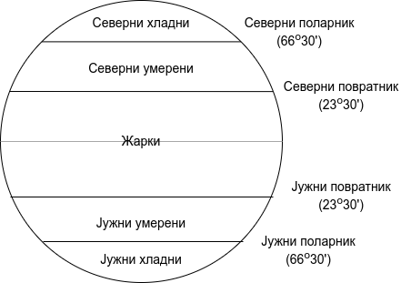

*Аутор: Филип Марић*

Планета Земља се дели на следећих 5 топлотних појасева:

- *жарки појас* се простире између северног и јужног повратника
- *северни умерени појас* се простире између северног повратника и
  северног поларника
- *северни хладни појас* се простире изнад северног поларника
- *јужни умерени појас* се простире између јужног повратника и
  јужног поларника
- *јужни хладни појас* се простире испод јужног поларника

Ако се зна да се повратници налазе на $23^\circ 30'$ северне односно
јужне географске ширине, а поларници на $66^\circ 30'$ северне односно
јужне географске ширине, напиши програм који на основу унете
географске ширине неког града одређује топлотни појас коме припада.

## Улаз

Са стандардног улаза се уноси географска ширина. Уноси се прво број
степени, затим број минута и онда слово `s` односно `j` које означава
да ли је у питању северна или јужна географска ширина. Претпоставити
да унети град није ни на једном повратнику ни на једном поларнику.

## Излаз

На стандардни излаз исписати ознаку `z` (жарки), `su` (северни
умерени), `sh` (северни хладни), `ju` (јужни умерени) или `jh` (јужни
хладни), у зависности од појаса коме унета географска ширина припада.

## Пример 1

### Улаз

~~~
15
28
j
~~~

### Излаз

~~~
z
~~~

### Објашњење

Пошто се град налази на јужној полулопти, али изнад јужног повратника, у питању је жарки појас.

## Пример 2

### Улаз

~~~
40
15
s
~~~

### Излаз

~~~
su
~~~

### Објашњење

Град се налази на северној полулопти, између северног повратника и северног поларника, па се налази
у северном умереном појасу.

## Пример 3

### Улаз

~~~
66
42
j
~~~

### Излаз

~~~
jh
~~~

### Објашњење

Град се налази на јужној полулопти, испод јужног поларника, па се налази у јужном хладном појасу.
