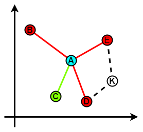

*Аутор: Милан Вугделија*

У једној дечијој игри, свако дете стоји поред свог дрвета, осим једног, којег ћемо звати кројач. 
Кројач нема дрво крај којег би стајао, већ иде од детета до детета и пита: "Код кога су маказице?". 
Упитано дете на то каже једно од имена остале деце. Док се кројач креће ка поменутом детету, сва 
остала деца покушавају да размене места, а кројач покушава да заузме неко дрво, тако што стигне 
до дрвета пре другог детета, или бар истовремено са њим. Ако у томе успе, његову улогу преузима 
дете које је остало без дрвета. 

У овом задатку се претпоставља да се сва деца крећу истом брзином и да кројач одмах примећује сваку 
започету размену места и креће ка ближем од два привремено слободна дрвета. Прво дете покушава да 
процени са колико друге деце би оно могло да размени место, а да их кројач не угрожава. Можете ли 
да му помогнете?

## Улаз

У првом реду стандардног улаза су два цела броја раздвојена размаком, координате кројача. У другом 
реду је један цео број $n$, број дрвећа, тј. број деце која нису кројач, не већи од 50. У сваком 
од наредних $n$ редова су по два цела броја раздвојена размаком, координате једног детета. Све 
координате су из интервала $[0, 30000]$.

## Излаз

На стандардни излаз исписати један цео број, број деце са којима прво дете може безбедно да размени 
место.

## Пример 1

### Улаз

~~~
19 7
5
11 11
3 17
8 4
14 3
18 15
~~~

### Излаз

~~~
1
~~~

### Објашњење

Кројач је означен тачком $K(19, 7)$, прво дете тачком $A(11, 11)$, а остала деца 
тачкама $B(3, 17)$, $C(8, 4)$, $D(14, 3)$ и $E(18, 15)$. 

- Растојање између $A$ и $B$ је $\sqrt{(11-3)^2+(11-17)^2}=\sqrt{64+36}=10$, а растојање између 
  $K$ и $A$ је $\sqrt{(19-11)^2+(7-11)^2}=\sqrt{64+16}=\sqrt{80}<10$, што значи да кројач стиже до тачке 
  $A$ пре него што $A$ и $B$ размене места, па та размена није безбедна;
- Растојање између $A$ и $C$ је $\sqrt{(11-8)^2+(11-4)^2}=\sqrt{9+49}=\sqrt{58}$, док су растојања 
  $KA=\sqrt{80}$ и $KC=\sqrt{(19-8)^2+(7-4)^2}=\sqrt{130}$ оба већа од $AC$, па $A$ и $C$ могу 
  безбедно да размене места;
- Растојање између $A$ и $D$ је $\sqrt{(11-14)^2+(11-3)^2}=\sqrt{9+64}=\sqrt{73}$, a растојањe 
  $KD=\sqrt{(19-14)^2+(7-3)^2}=\sqrt{25+16}=\sqrt{41}<AD$, па кројач стиже до тачке $D$ пре него што $A$ 
  и $D$ размене места;
- Растојање између $A$ и $E$ је $\sqrt{(11-18)^2+(11-15)^2}=\sqrt{49+16}=\sqrt{65}$, a растојањe 
  $KE=\sqrt{(19-18)^2+(7-15)^2}=\sqrt{1+64}=\sqrt{65}=AE$, па кројач стиже до тачке $E$ истовремено са $A$ 
  и размена места за $A$ и $E$ није безбедна.

Закључујемо да је од 4 разматране размене само једна безбедна (то је размена између $A$ и $C$), па на излаз 
треба исписати ``1``.
  
## Пример 2

### Улаз

~~~
100 100
4
50 50
150 50
50 150
150 150
~~~

### Излаз

~~~
0
~~~
