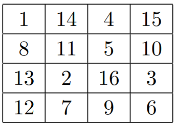

*Аутор: Огњен Тешић*

*Магични квадрат реда $n$* је квадрат димензија $n \times n$ попуњен бројевима код кога је збир бројева у свакој врсти (реду), свакој колони (ступцу) и свакој дијагонали једнак. Вредност свих тих збирова, $S$, назива се *карактеристични збир магичног квадрата*.

*Ђаволски квадрат реда $n$* (или *савршени*) је магичан квадрат димензија $n \times n$ попуњен бројевима код кога је збир бројева и на свакој „изломљеној” дијагонали једнак карактеристичном збиру $S$. Под изломљеном дијагоналом подразумевамо дијагоналу квадрата која се може добити од полазног, ако би се квадрат поделио на 2 правоугаоника, па затим да ти правоугаоници замене места.

Један пример ђаволског квадрата је на слици испод.

Дати квадрат је магични пошто је збир у свакој врсти, колони и дијагонали једнак $34$. Збирови у изломљеним дијагоналама су $14 + 5 + 3 + 12 = 34$, $4 + 10 + 13 + 7 = 34$, $15 + 8 + 2 + 9 = 34$, $4 + 11 + 13 + 6 = 34$, $14 + 8 + 3 + 9 = 34$ и $1 + 10 + 16 + 7 = 34$, па је унети квадрат ђаволски.

## Улаз

У првом реду стандардног улаза се уноси природан број $n$ ($3\leqslant n\leqslant 1000$).

У наредних $n$ редова се уноси $n$ природних бројева. Сви елементи квадрата су природни бројеви мањи или једнаки од $10^6$.

### Додатна ограничења
Тест примери су подељени у 4 дисјунктне (независне) група:
- У тест примерима вредним $14$ поена ће важити $n\leqslant 4$;
- У тест примерима вредним $15$ поена ће важити $n\leqslant 8$;
- У тест примерима вредним $32$ поена ће важити $n\leqslant 100$;
- У тест примерима вредним $39$ поена ће важити $n\leqslant 1000$;

## Излаз

На излаз треба исписати једну од порука `nije ni magican ni djavolski`, `jeste magican ali nije djavolski` или `djavolski`.  **Молимо Вас да испоштујете овај формат излаза. Потребно је исписати реч(и) малим словима иначе решење неће бити признато.**

## Пример 1

### Улаз

~~~
4
1 14 4 15
8 11 5 10
13 2 16 3
12 7 9 6
~~~

### Излаз

~~~
djavolski
~~~

## Пример 2

### Улаз

~~~
6
35 1 6 26 19 24
3 32 7 21 23 25
31 9 2 22 27 20
8 28 33 17 10 15
30 5 34 12 14 16
4 36 29 13 18 11
~~~

### Излаз

~~~
jeste magican ali nije djavolski
~~~

## Пример 3

### Улаз

~~~
3
1 1 1
1 1 1
1 1 2
~~~

### Излаз

~~~
nije ni magican ni djavolski
~~~
