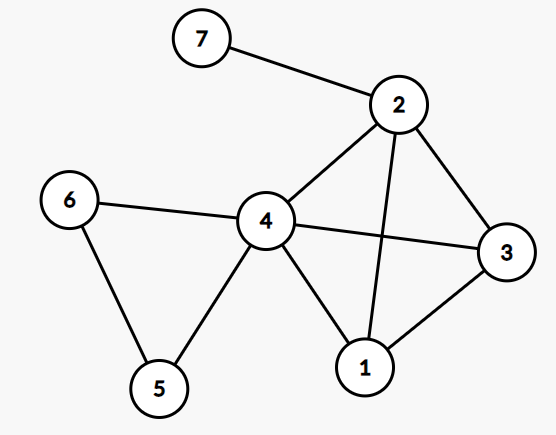

*Аутор: Немања Мајски*

Дат је граф са $n$ чворова означених бројевима $1,2,3,\ldots, n$. Чворови су подељени у $m$ скупова, при чему један чвор може бити у више скупова. За све чворове у графу важи да су граном повезани са свим оним чворовима са којима се налазе у истом скупу и ни са једним другим чвором (чворови су повезани ако постоји скуп који их оба садржи, а нису повезани ако не постоји такав скуп). У графу такође важи да за сваки пар скупова $A$ и $B$, постоји неки чвор $v$ такав да сви путеви који почињу у било ком чвору $a \in A$ и завршавају у било ком чвору $b \in B$ морају проћи кроз $v$. 

*Растојање између два различита чвора*, у ознаци $d(a,b)$ за $a\neq b$, дефинишемо као минимални број грана преко којих је потребно прећи да се дође од $a$ до $b$. Израчунајте збир растојања између свака два чвора у датом графу. Формалније, треба да израчунате 

$$\displaystyle\sum_{i = 1}^n \sum_{j = i+1}^n d(i, j)$$

## Улаз

Прва линија стандардног улаза садржи два природна броја $n$ и $m$ ($1 \leq n, m \leq 3 \cdot 10^5$) - број чворова и број скупова у графу. 

Наредних $m$ линија садрже описе скупова. $i$-та од тих линија описује $i$-ти скуп: прво број у линији је број $k_i$ ($2 \leq k_i \leq n$) - величина $i$-тог скупа. Затим следи $k_i$ бројева: $s_{i,1}, s_{i,2}, \ldots, s_{i,k_i}$ (сви су мањи или једнаки са $n$) - елементи $i$-тог скупа. Ове вредности су међусобно различите. Сви бројеви су међусобно одвојени размацима.

Нека је $p$ збир величина свих скупова. Гарантује се да је $p \leq \dfrac{26}{5} \cdot n$. Такође, гарантује се да **ниједан скуп није подскуп другог скупа.**

### Додатна ограничења
Tест примери су подељени у групе, тј. подзадатке, који се независно бодују:
- у тест примерима вредним $6$ поена важи $n\leq 15$ и величина свих скупова је $2$
- у тест примерима вредним $8$ поена важи $n\leq 100$ и величина свих скупова је $2$
- у тест примерима вредним $9$ поена важи $n\leq 2000$ и величина свих скупова је $2$
- у тест примерима вредним $26$ поена је величина свих скупова $2$
- у тест примерима вредним $7$ поена важи $n\leq 1000$
- у тест примерима вредним $26$ поена важи $n\leq 5000$
- у тест примерима вредним $18$ поена нема додатних ограничења

## Излаз

На стандардни излаз исписати један природан број - збир растојања између свака два чвора.

## Пример

### Улаз

~~~
7 3
4 1 2 3 4
3 4 5 6
2 7 2
~~~

### Излаз

~~~
34
~~~

*Објашњење:* Граф у примеру је приказан испод. Растојања између свака два чвора су следећа: $d(1,2)=1$, $d(1,3)=1$, $d(1,4)=1$, $d(1,5)=2$, $d(1,6)=2$, $d(1,7)=2$, $d(2,3)=1$, $d(2,4)=1$, $d(2,5)=2$, $d(2,6)=2$, $d(2,7)=1$, $d(3,4)=1$, $d(3,5)=2$, $d(3,6)=2$, $d(3,7)=2$, $d(4,5)=1$, $d(4,6)=1$, $d(4,7)=2$, $d(5,6)=1$, $d(5,7)=3$, $d(6,7)=3$ (приказана су и у табели испод).

  <table border="1" style="margin: auto;">
    <tr>
      <th></th>
      <th>1</th>
      <th>2</th>
      <th>3</th>
      <th>4</th>
      <th>5</th>
      <th>6</th>
      <th>7</th>
    </tr>
    <tr>
      <th>1</th>
      <td>-</td>
      <td>1</td>
      <td>1</td>
      <td>1</td>
      <td>2</td>
      <td>2</td>
      <td>2</td>
    </tr>
    <tr>
      <th>2</th>
      <td>-</td>
      <td>-</td>
      <td>1</td>
      <td>1</td>
      <td>2</td>
      <td>2</td>
      <td>1</td>
    </tr>
    <tr>
      <th>3</th>
      <td>-</td>
      <td>-</td>
      <td>-</td>
      <td>1</td>
      <td>2</td>
      <td>2</td>
      <td>2</td>
    </tr>
    <tr>
      <th>4</th>
      <td>-</td>
      <td>-</td>
      <td>-</td>
      <td>-</td>
      <td>1</td>
      <td>1</td>
      <td>2</td>
    </tr>
    <tr>
      <th>5</th>
      <td>-</td>
      <td>-</td>
      <td>-</td>
      <td>-</td>
      <td>-</td>
      <td>1</td>
      <td>3</td>
    </tr>
    <tr>
      <th>6</th>
      <td>-</td>
      <td>-</td>
      <td>-</td>
      <td>-</td>
      <td>-</td>
      <td>-</td>
      <td>3</td>
    </tr>
    <tr>
      <th>7</th>
      <td>-</td>
      <td>-</td>
      <td>-</td>
      <td>-</td>
      <td>-</td>
      <td>-</td>
      <td>-</td>
    </tr>
  </table>

Њихов збир је $34$.
 

