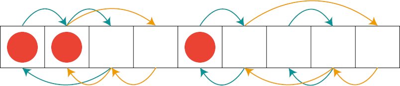
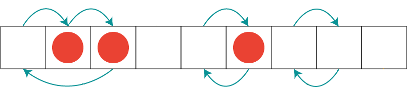
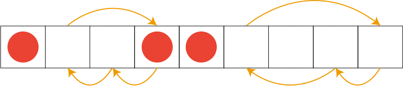

Александри је привукла пажњу једна чудна "игра на срећу". Машина за игру има $n$ кутија, у сваку од којих може да се стави највише по једна лоптица. Када играч распореди лоптице како жели, машина затвара кутије и меша их. Када се мешање заврши, играч треба да погоди у којим кутијама су лоптице, а у којим нису. Ако погоди, играч добија велику суму новца као награду.   

Многи верују да је ово игра на срећу, али Александра не мисли тако. Она је пажљиво посматрала машину и приметила је да она меша кутије у корацима. Као један корак, машина увек користи неко од фиксног броја ($m$) мешања кутија, која су Александри сва већ позната. Оно што Александра не може да предвиди је колико таквих корака ће машина да искористи у једној игри, односно која од тих $m$ познатих мешања ће колико пута да употреби и у ком редоследу.
 

Приметимо да са $0$ или са свих $n$ лоптица може једноставно да се победи, јер се у том случају зна да се лоптице и пре и после мешања не налазе ни у једној кутији, односно да се налазе у свим кутијама. Овакво играње је дозвољено, али је толико скупо да се не исплати.
 

Иако Александра презире материјална добра попут новца, овај проблем је изједа и не може да спава већ данима. Она тренутно има $k$ лоптица за играње ове игре. Помозите Александри да се наспава и успут вероватно освоји гомилу новца: **за дати број лоптица $k$ проверите да ли Александра некако може да их стави у машину тако да сигурно може да предвиди где се оне налазе након мешања. Ако то није могуће, одредите најмањи број лоптица које Александра мора да докупи или одбаци како би сигурно могла да победи.**

## Улаз

У првом реду стандардног улаза уносе се природни бројеви $n \leq 2 \cdot 10^4,k \leq n$, $m \leq 2 \cdot 10^5$ и $n \cdot m \leq 10^6$.  
То су редом број кутија, број лоптица које Александра има и број мешања која машина уме да изврши као један корак. У наредних $m$ линија уносе се мешања која машина може да изврши као један корак. Свака од $m$ линија је пермутација низа $1,2,3,...,n$ (линија улаза садржи сваки од тих бројева по једном). 

На пример ако је једна пермутација $2, 4, 3, 1$ то означава да је кутија $1$ отишла на место кутије $2$, кутија $2$ на место кутије $4$, кутија $4$ на место кутије $1$, а кутија $3$ је остала на истом месту.

## Излаз

У једном реду стандардног излаза исписати најмањи број лоптица које Александра мора да докупи или одбаци како би сигурно могла да победи.

### Додатна ограничења

Tест примери су подељени у групе, тј. подзадатке, који се независно бодују:

- у тест примерима вредним **13 поена** је број могућих мешања $m = 1$. Додатно је гарантовано да ће пермутација бити следећег облика: "$2,3,4,...,l,1,l+1,l+2,...,n$" (нпр: $2,3,4,5,1,6,7,8$).
- у тест примерима вредним **15 поена** је број могућих мешања $m = 1$. Нека је то једино мешање $a_1, a_2, ..., a_n$. Додатно важи да ово мешање само размењује неке парове лоптица, а остале оставља непромењене - тј. за свако $i$ важи $a_{a_i} = i$.
- у тест примерима вредним **14 поена** важи $m \leq 10$ и додатно је гарантовано да ће свако мешање бити један циклус. На пример $3,2,4,1,5$ је валидно мешање у овом подзадатку док $3,5,4,1,2$ није.
- у тест примерима вредним **29 поена** је гарантовано следеће: нека је број лоптица након куповања / oдбацивања најмањег броја лоптица једнак $x$. Гарантовано је да ако Александра стави све лоптице у првих $x$ кутија онда ће моћи да победи.
- у тест примерима вредним **29 поена** нема додатних ограничења.

## Пример 1

### Улаз

~~~
9 3 2
2 3 1 4 6 5 8 7 9
1 4 2 3 5 9 7 6 8
~~~

### Излаз

~~~
1
~~~

## Објашњење

На које год три позиције да Александра покуша да смести лоптице машина ће моћи да их измеша тако да Александра не може да буде сигурна где су завршиле лоптице. На пример ако постави лоптице на следећа места:

Машина их може измешати на следећи начин:

Или, на пример, на овај начин:

За сваке три позиције постоји више од једног начина на које машина може да измеша лоптице, па Александра не може да победи са три лоптице. Најближи број лоптица са којим може да победи је 4, а потребно је да их постави на места 1,2,3 и 4.

## Пример 2

### Улаз

~~~
9 5 2
2 1 4 5 3 6 7 9 8
2 1 4 3 6 5 8 9 7
~~~

### Излаз

~~~
0
~~~

## Објашњење

Александра може да постави свих $5$ лоптица на позиције $1,2,7,8$ и $9$. Тада ће без обзира на мешање увек знати у којим кутијама ће бити лоптица, а у којима не.
