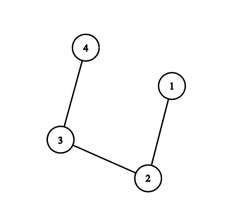
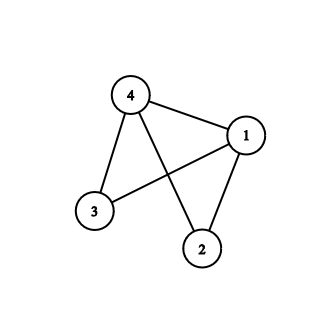
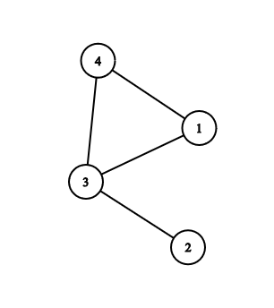
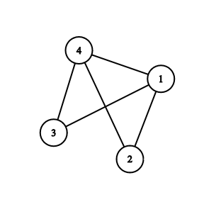

<br>

Вукашин је водоинсталатер. Његов клијент има мрежу од $N$ чворова, који су међусобно повезани са $M$ цеви. Зваћемо ово _мрежом_ цеви. За сваку цев је дато која два чвора повезује. Свака цев повезује два различита чвора и не постоје две цеви које повезују исти пар чворова.

Вукашин зна како би мрежа цеви требало да изгледа - између датих $K$ парова чворова треба да постоји тачно једна цев. Гарантује се да ни у циљној мрежи не постоји цев која би требала да повеује чвор са самим собом, као и да сваке две цеви повезују различит пар чворова.

<br>

Коришћењем свог водоинсталатерског умећа, Вукашин у једном потезу може да изабере произвољан чвор $u$ и потом уклони све цеви које су биле повезане са њим, а дода цеви према чворовима до којих до пре операције није постојала цев. Другим речима, после операције постоји цев између $u$ и $v$ ако и само ако та цев није постојала пре операције. Остале цеви (тј. оне које нису повезивале $u$) остају недирнуте.

<br>

Помозите Вукашину и испишите најмањи број операција које је неопходно применити тако да се од почетне добије крајња мрежа чворова. **Гарантује се да су примери такви да решење постоји**.

<br>

## Опис улаза

<br>

У првој линији стандардног улаза дат су три цела броја $N$, $M$ и $K$ - број чворова, број цеви у почетној мрежи и број цеви у крајњој мрежи редом.

<br>

Наредних $M$ линија описује почетну мрежу чворова. У $i$-тој од њих налазе се цели бројеви $u_i$ и $v_i$ - индекси чворова које $i$-та цев почетне мреже повезује.

<br>

Наредних $K$ линија описује циљну мрежу чворова. У свакој од њих налазе се цели бројеви $x_i$ и $y_i$ - индекси чворова које $i$-та цев циљне мреже повезује.

<br>

## Опис излаза

<br>

У једној линији стандардног излаза испишите један цео број - минималан број потребних операција.

<br>

## Пример 1

<br>

### Улаз

<br>

```
4 3 5
1 2
2 3
3 4
1 4
4 3
2 1
2 4
3 1
```

<br>

### Излаз

<br>

```
2
```

### Објашњење

<br>

Почетна мрежа чворова је:
<br>

<br>
А циљна мрежа је:
<br>

<br>
Прво применимо операцију на чвор $1$. Он је био повезан са чвором $2$. Дакле, након примене операције:

- Цев између чворова $1$ и $2$ више не постоји.
- Додаје се цев између чворова $1$ и $3$.
- Додаје се цев између чворова $1$ и $4$.

Дакле, након примене операције мрежа цеви изгледа овако:
<br>

<br>
Потом применимо операцију на чвор $2$. Он је пре примене операције био повезан са чвором $3$. Након примене операције:

- Додаје се цев између чвора $2$ и чвора $1$.
- Склања се цев између чвора $2$ и чвора $3$.
- Додаје се цев између чвора $2$ и чвора $4$.

Након примене ове операције, добијамо циљну мрежу цеви, тј:
<br>

<br>
## Пример 2

<br>

### Улаз

<br>

```
3 2 2
1 2
2 3
3 2
2 1
```

<br>

### Излаз

<br>

```
0
```

### Објашњење

<br>
Почетна и циљна мрежа чворова су исте, те према томе није неопходна ниједна примена операције.
<br>

## Пример 3

<br>

### Улаз

<br>

```
3 0 2
1 2
1 3
```

<br>

### Излаз

<br>

```
1
```

### Објашњење

<br>

У почетној мрежи нема ниједне цеви, док у циљној постоје само цеви између чвора $1$ и осталих чворова. Према томе, довољно је једном применити операцију и то управо на чвор $1$.

<br>

## Ограничења

<br>

- $2 \leq N \leq 10^3$

- $0 \leq M \leq \frac{N(N-1)}{2}$

- $1 \leq u_i \neq v_i \leq N$, за $1 \leq i \leq M$

- $\{u_i, v_i\} \neq \{u_j, v_j\}$, за $1 \leq i < j \leq M$

- $0 \leq K \leq \frac{N(N-1)}{2}$

- $1 \leq x_i \neq y_i \leq N$, за $1 \leq i \leq K$

- $\{x_i, y_i\} \neq \{x_j, y_j\}$, за $1 \leq i < j \leq K$

<br>

Тест примери су подељени у $5$ дисјунктних група:

- У тестовима вредним $6$ поена: Важи $N = 2$.
- У тестовима вредним $11$ поена: Важи $N \leq 20$.
- У тестовима вредним $21$ поена: Важи да је довољна примена највише две операције.
- У тестовима вредним $26$ поена: Важи $M = 0$.
- У тестовима вредним $36$ поена: Без додатних ограничења.

<br>

## Напомена

<br>

Приметите и да графови из улаза могу да буду празни, тј. без иједне гране.

<br>
