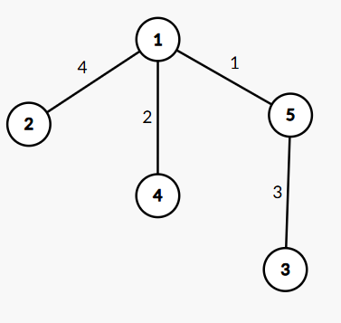

*Аутор: Александар Николић*

Град је прекривен снегом, али су све улице ипак проходне. Град можемо да представимо као стабло са $N$ раскрсница и $N-1$ улица (све улице су двосмерне).

Свака улица мора да добије тачно један број од $1$ до $N-1$, при чему се сваки број може употребити највише једном. Тај број представља количину снега која успорава пролазак том улицом.

Након доделе бројева, дефинишемо $\text{Dist}(u, v)$ као укупан збир бројева улица на јединственој путањи између раскрсница $u$ и $v$.

Ваш задатак је да одредите такву доделу бројева улицама да укупна сума свих $\text{Dist}(u, v)$ за $1 \le u < v \le N$ буде **минимална**.

## Улаз

У првом реду дат је цео број $N$, број раскрсница у граду.

У наредних $N-1$ редова дата су по два цела броја $u$ и $v$, који означавају да су раскрснице $u$ и $v$ спојене једном улицом.

## Излаз

Исписати минималну могућу вредност тражене суме.

## Ограничења

$2 \le N \le 100\,000$  
$1 \le u, v \le N$  

## Подзадаци

Тест примери су подељени у пет група:
- у тест примерима вредним 10 поена важи:  $N \le 8$;
- у тест примерима вредним 15 поена важи:  $N \le 20$;
- у тест примерима вредним 25 поена важи:  $N \le 2000$;
- у тест примерима вредним 20 поена важи:  стабло је ланац, односно сваки чвор $i$ је повезан са $i - 1$ за $i \ge 2$;
- у тест примерима вредним 30 поена нема додатних ограничења;

## Пример 1

### Улаз

~~~
4
1 2
2 3
2 4
~~~

### Излаз

~~~
18
~~~

## Пример 2

### Улаз

~~~
5
1 5
2 1
5 3
1 4
~~~

### Излаз

~~~
42
~~~

### Објашњење другог примера
Раскрснице и улице града из примера изгледају као на слици испод. Такође, на слици је приказан један начин доделе бројева од $1$ до $4$ улицама.

Израчунавамо сва растојања $\text{Dist}(u,v)$ за $1 \le u < v \le 5$:

- $\text{Dist}(1,2)=4$
- $\text{Dist}(1,3)=1+3=4$
- $\text{Dist}(1,4)=2$
- $\text{Dist}(1,5)=1$

- $\text{Dist}(2,3)=4+1+3=8$
- $\text{Dist}(2,4)=4+2=6$
- $\text{Dist}(2,5)=4+1=5$

- $\text{Dist}(3,4)=3+1+2=6$
- $\text{Dist}(3,5)=3$

- $\text{Dist}(4,5)=2+1=3$

Збир свих растојања је
$$
4+4+2+1+8+6+5+6+3+3 = 42.
$$

Може се доказати да није могуће направити овај збир мањим.
