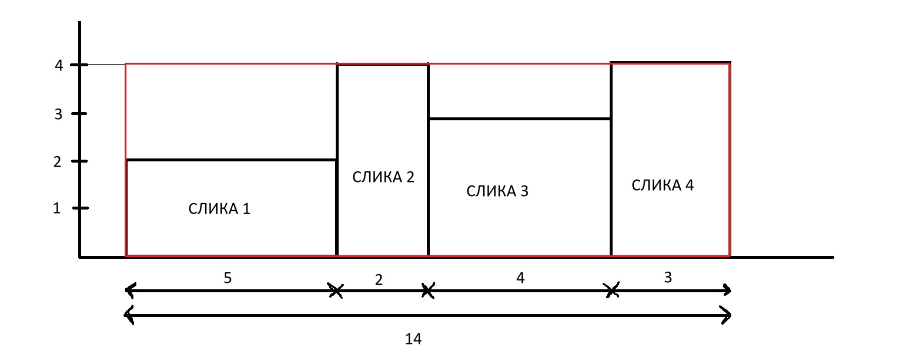

*Аутори: Филип Марић, Душан Попадић*

На интернет страници слике се слажу једна поред друге у ред. Слике могу бити различите висине и ширине. 
Слике се равнају тако да им доње ивице буду у линији, а десна
ивица тренутне слике се поклапа са левом ивицом наредне слике. На сајт треба сложити 4 слике.
Потребно је одредити колика ће бити висина и ширина реда слика уколико су познате димензије сваке појединачно.

## Улаз

У 4 реда стандардног улаза се уносе по два броја који представљају редом ширину и висину слике. Ови бројеви су природни и највише 100.

## Излаз

У једном реду стандардног излаза исписати два природна броја: прво ширину, а затим висину реда који садржи све слике.

## Пример 1

### Улаз

~~~
5 2
2 4
4 3
3 4
~~~

### Излаз

~~~
14 4
~~~

### Објашњење

Када се слике ређају једна поред друге ширина реда у који се ређају ће бити 14. Висина реда је таква да у њега може да стане и највиша слика - дакле 4.
Погледај слику која иде уз пример. Црвеним правоугаоником је обележен ред на страници који слике заузимају.

## Пример 2

### Улаз

~~~
2 6
17 5
12 6
14 2
~~~

### Излаз

~~~
45 6
~~~

## Пример 3

### Улаз

~~~
18 3
15 3
1 3
1 3
~~~

### Излаз

~~~
35 3
~~~
