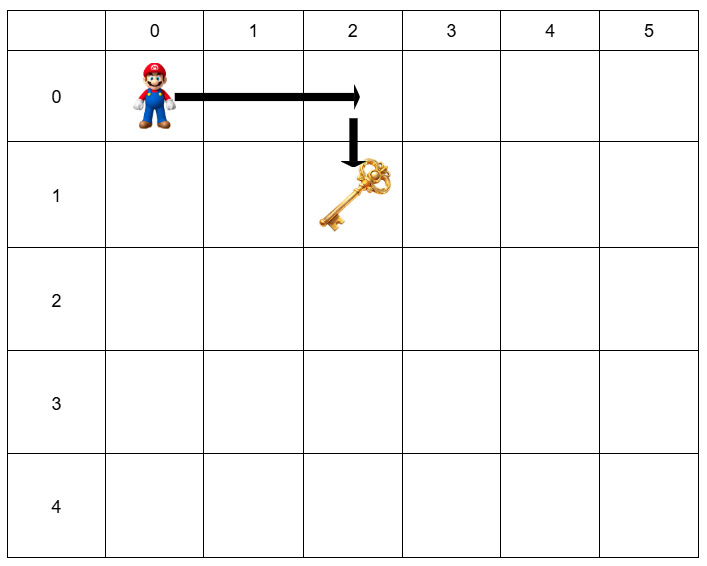
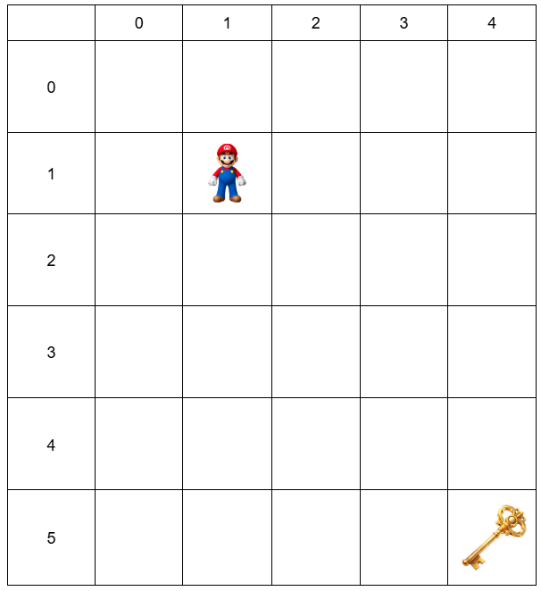
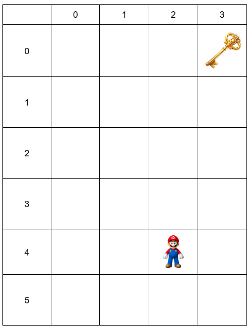

*Аутори: Филип Марић и Теодора Обрадовић*

Лик се у игрици може померати нагоре, надоле, налево и надесно.
Екран је правоугаоног облика, ширине $W$ и висине $H$ пиксела.

Положаји на екрану задати су паром целобројних координата $(x, y)$, при чему:
- $x$ означава удаљеност од леве ивице екрана и може имати вредности од $0$ до $W-1$,
- $y$ означава удаљеност од горње ивице екрана и може имати вредности од $0$ до $H-1$.

Горњи леви угао екрана има координате $(0, 0)$, а доњи десни угао $(W-1, H-1)$.

Ако се лик помери улево са координате $x=0$, појављује се на координати $x=W-1$.
Ако се помери удесно са координате $x=W-1$, појављује се на координати $x=0$.

Слично, ако се помери нагоре са координате $y=0$, појављује се на координати $y=H-1$,
а ако се помери надоле са координате $y=H-1$, појављује се на координати $y=0$.

Ако су познате почетна позиција лика и позиција кључа који је потребно
да покупи да би прешао на наредни ниво, напиши програм који одређује
**најмањи број пиксела** за који лик треба да се помери да би стигао до кључа.

## Улаз

Са стандардног улаза се, из првог реда, учитавају ширина $W$ и висина $H$ екрана
(природни бројеви од $3$ до $1000$), затим координате лика из другог реда, па координате кључа из трећег реда.

## Излаз

На стандардни излаз исписати тражени најмањи број пиксела.

## Бодовање
Решење се тестира на $25$ тест примера који нису наведени у тексту задатка, при чему сваки од њих носи по $4$ поена. Као коначан број бодова на овом задатку рачуна се број бодова Вашег најбољег послатог решења.

## Пример 1

### Улаз

~~~
6 5
0 0
2 1
~~~

### Излаз

~~~
3
~~~

### Објашњење

Лик треба да се помери $2$ пиксела надесно и $1$ пиксел надоле.

## Пример 2

### Улаз

~~~
5 6
1 1
4 5
~~~

### Излаз

~~~
4
~~~

### Објашњење

По $x$-оси је краће да иде налево. После $1$ пиксела стиже до леве ивице, 
па још једним померањем улево се појављује са десне стране и стиже на $x$-координату $4$,
па укупно по $x$-оси пређе $2$ пиксела.

По $y$-оси је краће да иде нагоре. После $1$ пиксела стиже до горње ивице,
па још једним померањем нагоре се појављује на дну екрана,
па укупно по $y$-оси пређе $2$ пиксела.

Зато је укупан најмањи број пиксела $2+2=4$.

## Пример 3

### Улаз

~~~
4 6
2 4
3 0
~~~

### Излаз

~~~
3
~~~

### Објашњење

По $x$-оси лик треба да се помери $1$ пиксел надесно.

По $y$-оси је краће да иде надоле. После $1$ пиксела стиже до доње ивице,
па померањем још једном надоле се појављује на врху екрана,
па укупно по $y$-оси пређе $2$ пиксела.

Зато је укупан најмањи број пиксела $1+2=3$.

