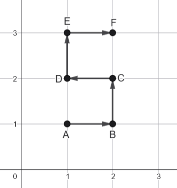

*Аутор: Никола Чутурић*

Нови Менхетн је град чију уличну мрежу чине улице и булевари. Улице се пружају правцем исток–запад, булевари правцем север–југ, а свака улица и сваки булевар секу се под правим углом. Улице су на мапи града означене редним бројевима од југа ка северу, а булевари редним бројевима од запада ка истоку.

Клара се кретала кроз град, а познат је низ раскрсница кроз које је редом пролазила. Прва задата раскрсница представља место са ког је Клара кренула.

За сваку раскрсницу, осим прве и последње, може се одредити да ли је на њој Клара скренула лево или скренула десно.

Помозите Доктору и Клари да одреде колико је највише пута **узастопно** Клара скренула **лево**.

## Улаз

У првом реду стандардног улаза налази се један цео број $N$ $(3 \leq N \leq 10^5)$ - број задатих раскрсница.

У наредних $N$ редова налазе се по два цела броја $X_i$ и $Y_i$ $(1 \leq X_i, Y_i \leq 10^6)$, где $X_i$ означава број булевара, а $Y_i$ број улице. То су, редом, раскрснице кроз које је Клара пролазила.

Гарантује се да су сваке два суседне задате раскрснице различите и да припадају истој улици или истом булевару.

## Излаз

У једином реду стандардног излаза исписати један цео број - највећи број узастопних левих скретања које је Клара направила.

## Бодовање
Решење се тестира на $10$ тест примера који нису наведени у тексту задатка, при чему сваки од њих носи по $10$ поена. Као коначан број бодова на овом задатку рачуна се број бодова Вашег најбољег послатог решења.

## Пример

### Улаз

~~~
6
1 1
2 1
2 2
1 2
1 3
2 3
~~~

### Излаз

~~~
2
~~~

## Објашњење примера

Означимо редом задате раскрснице са $A, B, C, D, E, F$: $A=(1,1)$, $B=(2,1)$, $C=(2,2)$, $D=(1,2)$, $E=(1,3)$ и $F=(2,3)$.

Клара се, дакле, кретала путањом $A \to B \to C \to D \to E \to F$.

- На раскрсници $B$, кретала се од $A$ ка $B$, а затим од $B$ ка $C$, па је ту скренула лево.
- На раскрсници $C$, кретала се од $B$ ка $C$, а затим од $C$ ка $D$, па је ту скренула лево.
- На раскрсници $D$, кретала се од $C$ ка $D$, а затим од $D$ ка $E$, па је ту скренула удесно.
- На раскрсници $E$, кретала се од $D$ ка $E$, а затим од $E$ ка $F$, па је ту скренула удесно.

Зато је највећи број узастопних левих скретања једнак $2$.

